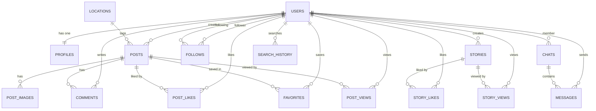

# DATABASE — schema of the Instagram-like API

| Field | Value |
|---|---|
| Version | v0.1 |
| Date | 2026-10-21 |
| Source of truth | the 16 entity files in `src/entities/` |
| ORM | TypeORM 1.x, SQLite file `backend/data/app.sqlite` |
| Config | `src/config/database.config.ts` — **currently broken**, see `docs/RISKS.md` RISK-001 |

Types are the ones TypeORM infers. `uq` = unique constraint, `PK` = primary key,
`FK` = foreign key. All tables use `id` as `PrimaryGeneratedColumn` (integer, auto
increment). A blank entity cell means "same entity as the row above".

## 1. Entities

| Entity | Field | Type | Rules / note |
|---|---|---|---|
| **users** | id | integer | PK, auto |
| | userName | varchar | **uq**, not null |
| | fullName | varchar | not null |
| | email | varchar | **uq**, not null |
| | password | varchar | bcrypt hash (FR-007), today plain text |
| | refreshToken | varchar | null, unused today |
| | createdAt / updatedAt | datetime | auto, `@CreateDateColumn` / `@UpdateDateColumn` |
| | profile | Profile | 1-1, cascade insert, `onDelete: CASCADE` |
| | posts / stories / comments / favorites | — | 4 × 1-N |
| | following / followers | Follow[] | 1-N on both sides of `follows` |
| **profiles** | id | integer | PK, auto |
| | userId | integer | **uq**, FK → users.id, `onDelete: CASCADE` |
| | bio | varchar | default `''`, max 150 chars (FR-022) |
| | avatar | varchar | default `''`, url of the uploaded file |
| | website | varchar | default `''`, max 200 chars |
| | gender | integer | default 0, enum: 0 = Male, 1 = Female |
| | isPrivate | boolean | default false, hides the posts from non-followers |
| | createdAt / updatedAt | datetime | auto |
| | user | User | 1-1, inverse side |
| **follows** | id | integer | PK, auto |
| | followerId | integer | FK → users.id, `onDelete: CASCADE` |
| | followingId | integer | FK → users.id, `onDelete: CASCADE` |
| | createdAt | datetime | auto |
| | — | — | **uq** (`followerId`, `followingId`) — FR-030 |
| **locations** | id | integer | PK, auto |
| | name | varchar | not null |
| | city / state / country / zipCode | varchar | all null by default |
| | createdAt / updatedAt | datetime | auto |
| | posts | Post[] | 1-N, inverse side |
| **posts** | id | integer | PK, auto |
| | userId | integer | FK → users.id, `onDelete: CASCADE` |
| | locationId | integer | null, FK → locations.id, `onDelete: SET NULL` |
| | title | varchar | null, max 300 chars |
| | content | varchar | default `''`, caption, max 2200 chars |
| | isReel | boolean | default false, true = reel (FR-047) |
| | createdAt / updatedAt | datetime | auto |
| | images / likes / views / comments / favorites | — | 5 × 1-N, cascade |
| **post_images** | id | integer | PK, auto |
| | postId | integer | FK → posts.id, `onDelete: CASCADE` |
| | url | varchar | path under `uploads/` |
| | order | integer | default 0, position of the image, 0…9 |
| | createdAt | datetime | auto |
| **post_likes** | id | integer | PK, auto |
| | postId | integer | FK → posts.id, `onDelete: CASCADE` |
| | userId | integer | FK → users.id, `onDelete: CASCADE` |
| | createdAt | datetime | auto |
| | — | — | **uq** (`postId`, `userId`) — FR-045 |
| **post_views** | id | integer | PK, auto |
| | postId | integer | FK → posts.id, `onDelete: CASCADE` |
| | userId | integer | FK → users.id, `onDelete: CASCADE` |
| | createdAt | datetime | auto |
| | — | — | **uq** (`postId`, `userId`) — FR-046 |
| **comments** | id | integer | PK, auto |
| | postId | integer | FK → posts.id, `onDelete: CASCADE` |
| | userId | integer | FK → users.id, `onDelete: CASCADE` |
| | content | varchar | 1–500 chars (FR-050) |
| | createdAt / updatedAt | datetime | auto |
| **favorites** | id | integer | PK, auto |
| | postId | integer | FK → posts.id, `onDelete: CASCADE` |
| | userId | integer | FK → users.id, `onDelete: CASCADE` |
| | createdAt | datetime | auto |
| | — | — | **uq** (`postId`, `userId`) — FR-060 |
| **stories** | id | integer | PK, auto |
| | userId | integer | FK → users.id, `onDelete: CASCADE` |
| | imageUrl | varchar | one image per story |
| | postId | integer | null, optional link to a post |
| | expiresAt | datetime | `createdAt + 24 h` (FR-071) |
| | createdAt | datetime | auto |
| | likes / views | — | 2 × 1-N, cascade |
| **story_likes** | id | integer | PK, auto |
| | storyId | integer | FK → stories.id, `onDelete: CASCADE` |
| | userId | integer | FK → users.id, `onDelete: CASCADE` |
| | createdAt | datetime | auto |
| | — | — | **uq** (`storyId`, `userId`) |
| **story_views** | id | integer | PK, auto |
| | storyId | integer | FK → stories.id, `onDelete: CASCADE` |
| | userId | integer | FK → users.id, `onDelete: CASCADE` |
| | createdAt | datetime | auto |
| | — | — | **uq** (`storyId`, `userId`) |
| **chats** | id | integer | PK, auto |
| | user1Id | integer | FK → users.id, `onDelete: CASCADE` |
| | user2Id | integer | FK → users.id, `onDelete: CASCADE` |
| | createdAt / updatedAt | datetime | auto |
| | messages | Message[] | 1-N, cascade |
| **messages** | id | integer | PK, auto |
| | chatId | integer | FK → chats.id, `onDelete: CASCADE` |
| | senderId | integer | FK → users.id, `onDelete: CASCADE` |
| | text | varchar | null, 1–2000 chars |
| | fileUrl | varchar | null, one optional file |
| | isRead | boolean | default false (FR-081) |
| | createdAt | datetime | auto |
| **search_history** | id | integer | PK, auto |
| | userId | integer | FK → users.id, `onDelete: CASCADE` |
| | text | varchar | null, free text query |
| | searchedUserId | integer | null, FK → users.id, `onDelete: CASCADE` |
| | createdAt | datetime | auto |

Two extra rules: in `chats`, `user1Id` is always the smaller id of the pair; in
`search_history`, a row holds `text` **or** `searchedUserId`, never both.

## 2. ER diagram

The field list is in §1 — the diagram only shows the relations.

## 3. Delete behaviour

| Parent deleted | Children | Rule |
|---|---|---|
| User | profile, posts, stories, comments, likes, views, favorites, follows, chats, messages, search history | CASCADE |
| Post | post_images, post_likes, post_views, comments, favorites | CASCADE |
| Story | story_likes, story_views | CASCADE |
| Chat | messages | CASCADE |
| Location | posts | SET NULL (post stays, `locationId` becomes null) |

## 4. Gaps to close (see `TASKS.md`)

1. No index is declared on any foreign key column (NFR-027).
2. `chats` has no unique constraint on the (`user1Id`, `user2Id`) pair (Q-13).
3. `posts.isReel` has no index, the reels query scans the whole table.
4. `stories.expiresAt` has no index, the "active stories" query scans the whole table.
5. `users` has no `role` column — the Admin role is undefined (Q-01).
6. `search_history` has no index on (`userId`, `createdAt`).
